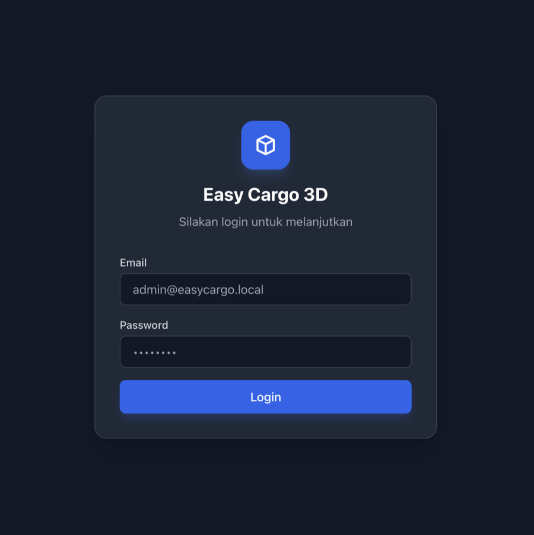
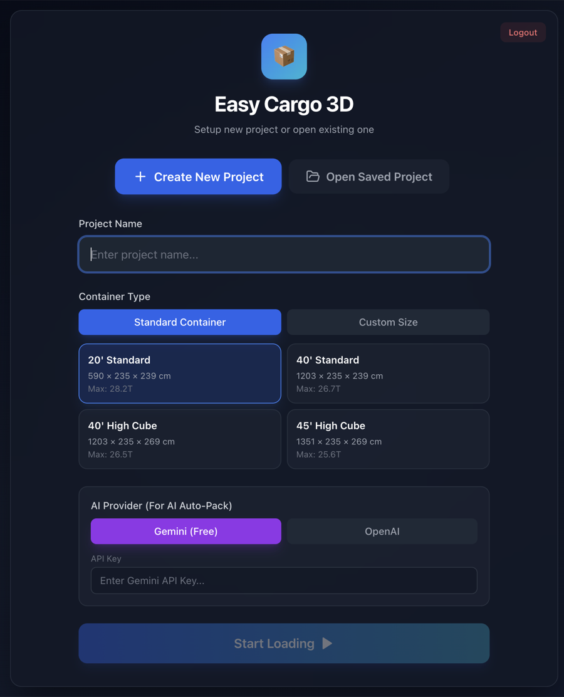
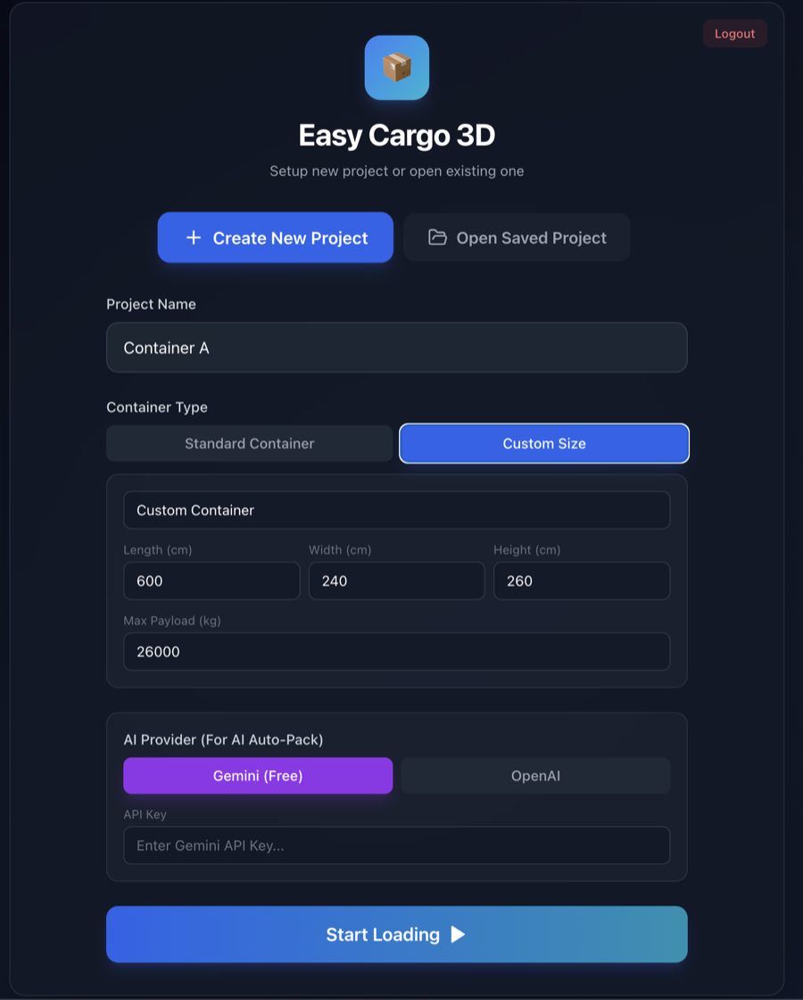
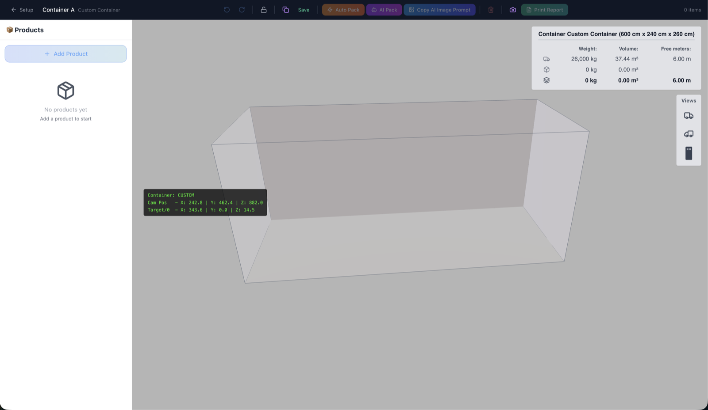
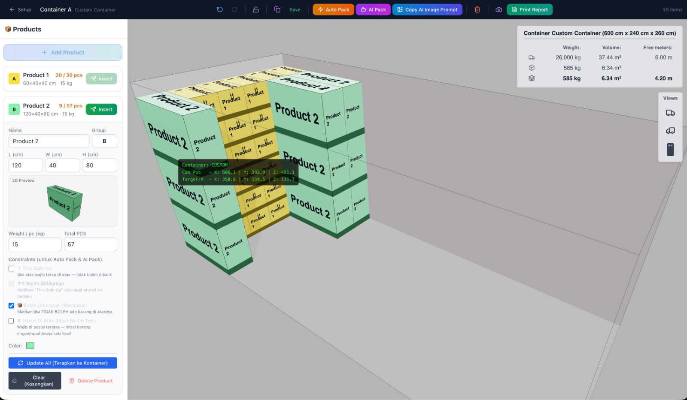
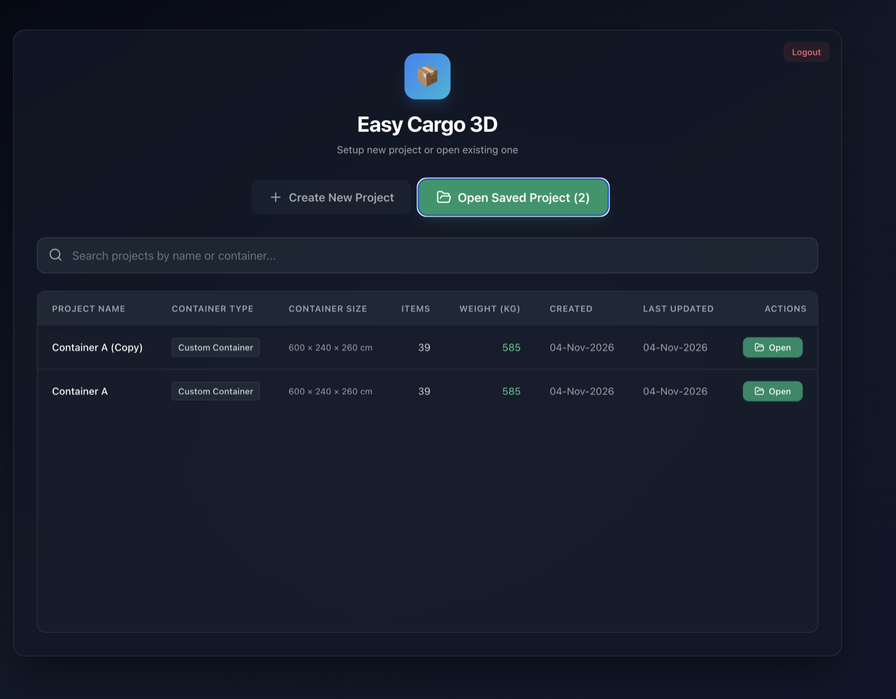
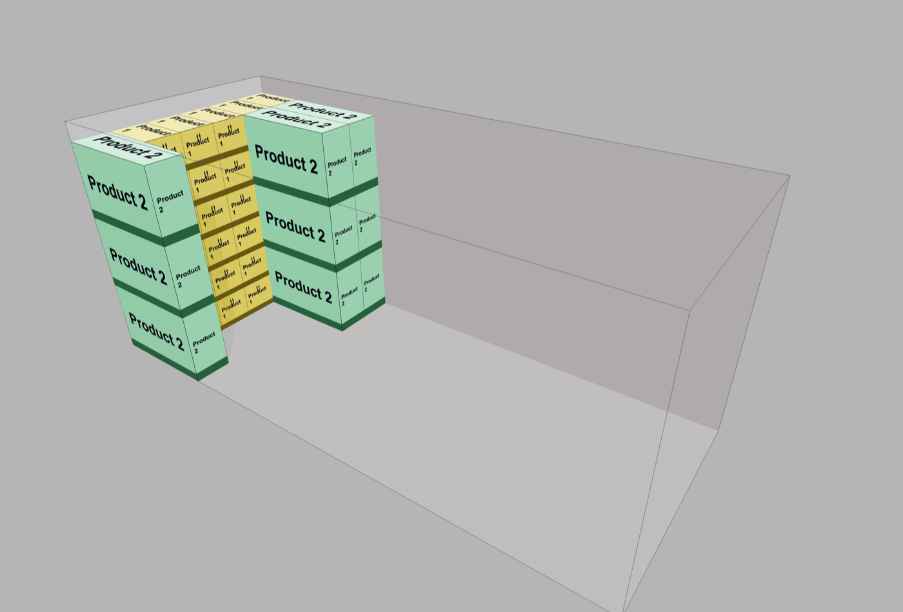

# Easy Cargo 3D — Container Loading Planner

Web app for planning how cartons are loaded into a shipping container. Pick a standard or custom container, add products with their size, weight and handling rules, then place them by hand, let the packing algorithm fill the container, or ask an AI model for a layout. Results are shown in 3D, saved per project, and exported as a PNG or a printable report.

Built with React + TypeScript + Three.js (React Three Fiber) on the frontend and Node.js + Express + Sequelize + MySQL on the backend.


---

## Contents

- [Walkthrough](#walkthrough)
- [Toolbar reference](#toolbar-reference)
- [Mouse and keyboard controls](#mouse-and-keyboard-controls)
- [Installation](#installation)
- [API endpoints](#api-endpoints)
- [Project structure](#project-structure)
- [Troubleshooting](#troubleshooting)

---

## Walkthrough

All screenshots use sample data (`Product 1`, `Product 2`).

### 1. Login



Sign in with an account from the `users` table. The seed script creates a default admin (see [Installation](#installation)). Login returns a JWT that the app sends with every API call; **Logout** ends the session.

### 2. Create a project with a standard container



The setup page has two modes: **Create New Project** and **Open Saved Project**.

1. Enter a **Project Name**.
2. Under **Container Type → Standard Container**, pick one of the built-in containers. Each card shows the inside dimensions and maximum payload:

   | Container | Inside size (L × W × H) | Max payload |
   |-----------|-------------------------|-------------|
   | 20' Standard | 590 × 235 × 239 cm | 28.2 t |
   | 40' Standard | 1203 × 235 × 239 cm | 26.7 t |
   | 40' High Cube | 1203 × 235 × 269 cm | 26.5 t |
   | 45' High Cube | 1351 × 235 × 269 cm | 25.6 t |

3. Optional: choose an **AI Provider** (Gemini or OpenAI) and paste your API key if you want to use **AI Pack** later. The key is kept only in the browser session and is not saved to the database or local storage.
4. Click **Start Loading**.

### 3. Or define a custom container size



Choose **Custom Size** to plan for a truck box, a pallet area or any non-standard space. Enter a name, **Length / Width / Height** in cm and **Max Payload** in kg.

### 4. Planner workspace



After **Start Loading**, the planner opens with:

- **Toolbar** (top): project name, undo/redo, save, packing tools, export. See [Toolbar reference](#toolbar-reference).
- **Products panel** (left): products for this project.
- **3D view** (center): the container drawn to scale. Drag to orbit, scroll to zoom.
- **Container stats** (top right): capacity, what is loaded and what remains.
  - Row 1 (truck icon): container capacity, weight and volume, and its length.
  - Row 2 (box icon): weight and volume of the items loaded so far.
  - Row 3 (layers icon): loaded totals and **Free meters**, the container length still free after loading (4.20 m of 6.00 m in step 5).
- **Views** (right): jump to the right-side, left-side or top view.

### 5. Add products and load them



Click **+ Add Product** and fill in the product form:

| Field | Meaning |
|-------|---------|
| Name | Product name, also printed on each box in 3D |
| Group | Letter used to group and color products (A, B, …) |
| L / W / H (cm) | Carton size |
| Weight / pc (kg) | Used for payload checks and totals |
| Total PCS | How many pieces of this product need to be loaded |
| Color | Box color in the 3D view |

**3D Preview** shows the carton with its label before it is placed.

**Constraints** are respected by both **Auto Pack** and **AI Pack**:

| Constraint | Effect |
|------------|--------|
| This Side Up | The top face must stay on top; the box is never flipped |
| Boleh Ditidurkan (can be laid down) | With This Side Up on, still allow laying the box on its side |
| Boleh Ditumpuk (stackable) | Other boxes may be placed on top; turn off for fragile items |
| Harus Di Atas (must be on top) | Must be placed in the top layer, e.g. light or fragile goods |

Each product card shows loaded vs. total quantity (for example `9 / 57 pcs`). Ways to load:

- **Insert**: places one piece at the next free position, packed tight from the front-left corner. Click repeatedly to add more.
- **Auto Pack** (toolbar): fills the container with all remaining pieces using the 3D bin-packing algorithm.
- **AI Pack** (toolbar): sends the container and product list to Gemini or OpenAI and places the returned layout.

Product actions:

- **Update All (Terapkan ke Kontainer)**: apply edited size, weight or rules to boxes already in the container.
- **Clear (Kosongkan)**: remove this product's boxes from the container but keep the product.
- **Delete Product**: remove the product and its boxes.

The item count in the top-right of the toolbar shows how many boxes are loaded (`39 items` in the screenshot).

### 6. Save and reopen projects



**Save** stores the project (container, products and every box position) in MySQL. The planner also auto-saves every 2 minutes while you work. **Open Saved Project** lists all projects with container type, size, item count, total weight and dates. Search by project or container name, then click **Open** to continue.

Use the **Duplicate Project** button in the toolbar to try another arrangement without changing the original. The copy appears as `Container A (Copy)`.

### 7. Export



- **Camera button**: downloads the current 3D view as a PNG (example above).
- **Print Report**: opens a 2-page report with the right and left views, container details and a product summary, ready to print or save as PDF.
- **Copy AI Image Prompt**: copies a ready-to-paste prompt, filled with the real container size and product list, for an AI image generator. It asks for four layout variants with right and left views.

---

## Toolbar reference

| Button | What it does |
|--------|--------------|
| ← Setup | Back to the project setup page |
| Project name | Double-click to rename |
| Undo / Redo | Step back or forward through layout changes |
| Lock | Lock or unlock camera rotation, useful while moving boxes |
| Duplicate | Copy the current project |
| Save | Save the project to the database |
| Auto Pack | Fill the container automatically (bin-packing algorithm) |
| AI Pack | Ask Gemini or OpenAI for a layout (needs an API key from setup) |
| Copy AI Image Prompt | Copy an image-generator prompt for this load |
| Trash | Remove all boxes from the container |
| Camera | Export the 3D view as PNG |
| Print Report | Open the printable 2-page report |

## Mouse and keyboard controls

Click a box in the 3D view to select it, then:

| Input | Action |
|-------|--------|
| Drag (empty space) | Orbit the camera |
| Scroll | Zoom |
| Arrow keys | Tip the selected box forward, backward, left or right |
| Shift + Arrow | Spin the selected box 90° around the vertical axis |
| Ctrl / Cmd + Arrow | Slide the selected box across the floor |
| Delete / Backspace | Remove the selected box |
| Esc | Deselect |
| Shift + D | Show or hide the camera debug overlay (the green text box in the screenshots) |

Rotations follow the product's constraints, so a This Side Up box will not tip over.

---

## Installation

### Requirements

- Node.js 18 or newer
- MySQL 8 or MariaDB 10.4+

### 1. Database

Create the database and import the dump, which includes the tables, the four standard containers, sample products and the default admin user:

```bash
mysql -u root -p -e "CREATE DATABASE IF NOT EXISTS \`easy-cargo\` CHARACTER SET utf8mb4 COLLATE utf8mb4_unicode_ci;"
mysql -u root -p easy-cargo < easy-cargo.sql
```

Or start from an empty database and run `npm run seed` after step 2.

### 2. Backend

Create a `.env` file in the project root:

```env
DB_HOST=localhost
DB_PORT=3306
DB_NAME=easy-cargo
DB_USER=root
DB_PASSWORD=
PORT=5000
NODE_ENV=development
JWT_SECRET=change-this-to-a-long-random-string
FRONTEND_URL=http://localhost:5000
```

```bash
npm install      # also installs frontend dependencies (postinstall)
npm run seed     # optional: default admin, containers and sample products
npm run dev      # or: npm start
```

### 3. Frontend

```bash
npm run build:frontend   # builds frontend/build, served by the backend
```

Open **http://localhost:5000**. The backend serves both the API (`/api`) and the built frontend.

Default login created by the seed and the SQL dump: `admin@easycargo.local` / `admin123`. Change it before using the app outside your own machine.

For frontend development with hot reload, run `npm start` inside `frontend/` (port 3000). Its `proxy` setting forwards API calls to port 5000.

---

## API endpoints

All endpoints except `POST /api/auth/login` need `Authorization: Bearer <token>`.

```
Auth
POST   /api/auth/login
GET    /api/auth/me

Projects
GET    /api/projects
POST   /api/projects/save
GET    /api/projects/:id
DELETE /api/projects/:id

Containers
GET    /api/containers
GET    /api/containers/system
GET    /api/containers/:id
POST   /api/containers/custom
PUT    /api/containers/:id
DELETE /api/containers/:id

Products
GET    /api/products
GET    /api/products/grouped
GET    /api/products/:id
POST   /api/products
PUT    /api/products/:id
DELETE /api/products/:id
PUT    /api/products/bulk/quantities
POST   /api/products/groups
PUT    /api/products/groups/:id

Layouts
GET    /api/layouts
GET    /api/layouts/:id
POST   /api/layouts
PUT    /api/layouts/:id
DELETE /api/layouts/:id
POST   /api/layouts/:id/auto-pack
POST   /api/layouts/:id/reset
GET    /api/layouts/:id/stats
POST   /api/layouts/:id/items
PUT    /api/layouts/items/:itemId
DELETE /api/layouts/items/:itemId
```

---

## Project structure

```
easy-cargo-3d/
├── src/                      # Express backend
│   ├── config/database.js    # Sequelize connection (reads .env)
│   ├── models/               # Sequelize models
│   ├── controllers/  routes/  services/  middleware/
│   ├── utils/binpacking.js   # server-side packing
│   ├── utils/seed.js         # default admin, containers, sample products
│   └── server.js             # API + serves frontend/build
├── frontend/                 # React + TypeScript app
│   └── src/
│       ├── components/       # LoginPage, LayoutSelector, Toolbar, ContainerViewer3D, ProductGroupManager, ContainerStatsOverlay
│       ├── pages/PlannerPage.tsx
│       ├── store/plannerStore.ts    # Zustand state, undo/redo, save/load
│       ├── hooks/useAutoSave.ts     # auto-save every 2 minutes
│       └── utils/            # binPacking, collisionDetection, aiPackService, aiImagePrompt, reportGenerator, exportUtils
├── docs/screenshots/         # images used in this README
├── easy-cargo.sql            # MySQL dump: schema + sample data
└── package.json
```

### Packing algorithm

Auto Pack (`frontend/src/utils/binPacking.ts`) uses an Empty Maximal Space (EMS) heuristic:

1. Pieces are sorted largest first. Pieces marked Harus Di Atas are held back and placed last, at the highest available level.
2. The free space inside the container is tracked as a list of empty boxes (maximal spaces); each piece goes into the best-fitting space and the list is updated.
3. Only orientations allowed by This Side Up and Boleh Ditidurkan are tried.
4. A piece is only placed above floor level on products marked Boleh Ditumpuk, and the total weight must stay within the container payload.

The **Insert** button uses a separate placement routine that tries positions along the edges of boxes already placed, so single pieces sit tight from the front-left corner.

---

## Troubleshooting

| Problem | Check |
|---------|-------|
| Server stops with a database error | MySQL is running and the `.env` values are correct |
| Page says the frontend build is not found | Run `npm run build:frontend` |
| Login fails | Import `easy-cargo.sql` or run `npm run seed` |
| AI Pack asks for a key | Go back to Setup and enter a Gemini or OpenAI API key |
| Some pieces are not loaded | Container full by volume or payload, or the constraints leave no valid position; the stats panel shows what is left |
| 3D view is blank | The browser needs WebGL enabled |

---

Developed by [A Yazid Bustomi](https://www.yazid-bustomi.my.id/)
